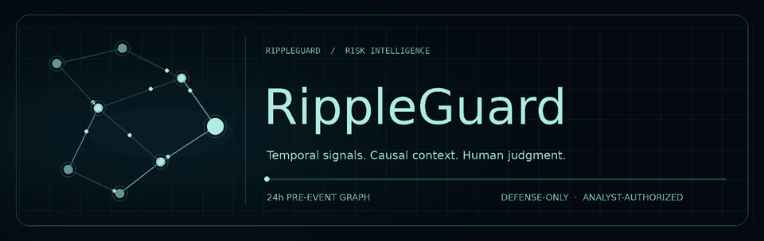
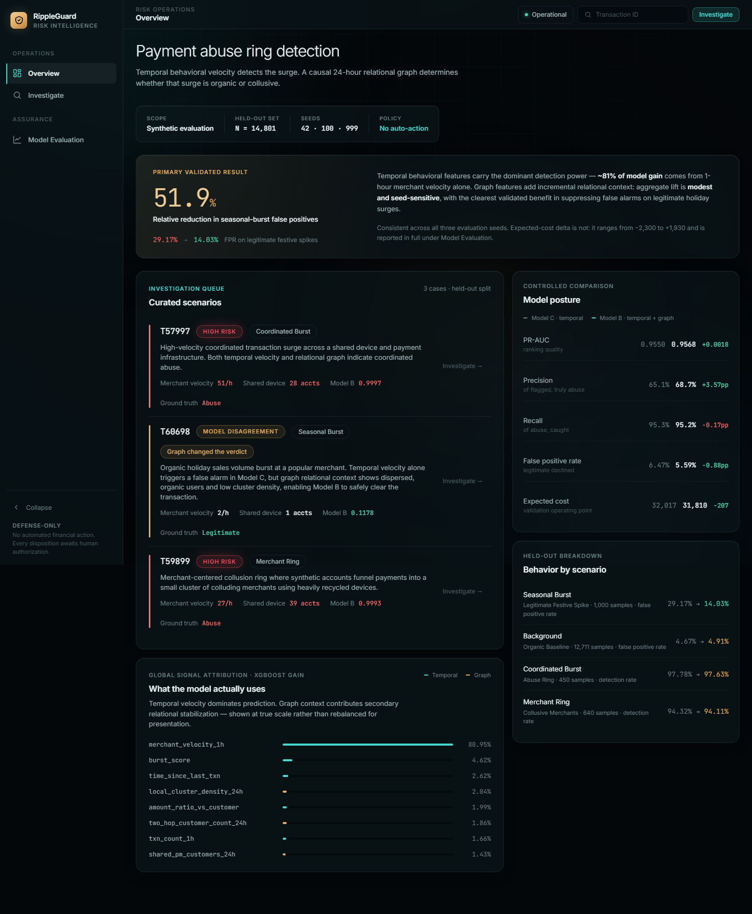
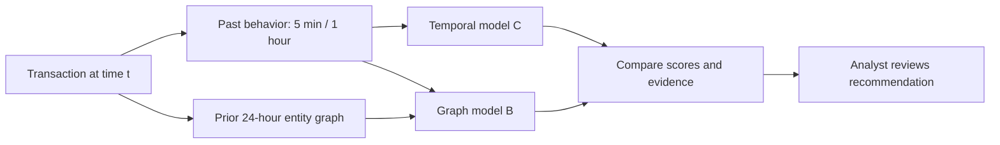
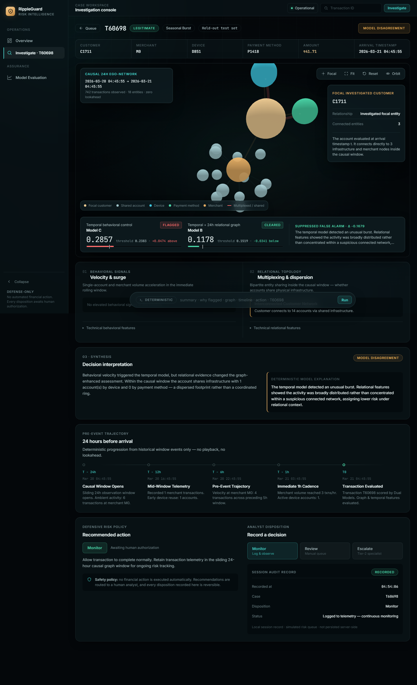
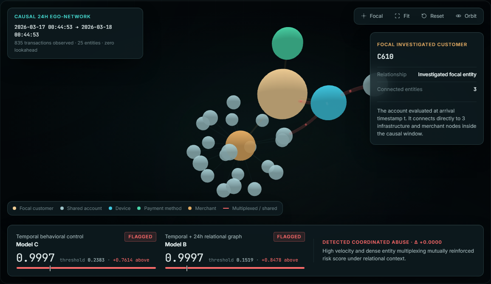

<h1 align="center">
  
</h1>

<p align="center">
  
</p>

<p align="center"><strong>Defense-only payment risk intelligence · Razorpay AI Risk Manager track</strong></p>
<p align="center">An analyst workspace that pairs behavioral velocity with a 24-hour pre-event entity graph to investigate coordinated abuse without confusing legitimate sales surges for fraud.</p>

<p align="center">
  <a href="#the-problem">Problem</a> · <a href="#how-it-works">System</a> · <a href="#evidence">Evidence</a> · <a href="#investigation-workspace">Product</a> · <a href="#run-locally">Run locally</a> · <a href="#methodology-and-limits">Methodology
  </a>
</p>

> [!IMPORTANT]
> **Synthetic-data research prototype.** The evaluation below is on generated transactions, not live Razorpay traffic. RippleGuard recommends defensive review actions; it never blocks a payment, freezes an account, or holds a settlement automatically. The Razorpay mark identifies the project track and does not imply a production integration or endorsement.

## At a glance

| 69,270 | 14,801 | 51.9% |
| :---: | :---: | :---: |
| Synthetic transactions over 90 days | Chronologically held-out test transactions | Relative reduction in *seasonal-burst false-positive rate* with graph context, averaged across three seeds (29.17% → 14.03%) |



## The problem

Transaction velocity is a useful abuse signal, but it cannot explain *why* activity is accelerating. Coordinated accounts can share devices and payment instruments while keeping each account's traffic modest. Conversely, an organic flash sale can trigger a surge in merchant volume. An analyst needs the transaction's recent behavior **and** the relationships behind it before deciding what to review.

RippleGuard compares two controlled XGBoost models: **Model C** uses eight temporal features; **Model B** adds five causal graph features. The graph is an incremental context layer. One-hour merchant velocity remains the dominant signal, accounting for about 81% of Model B's XGBoost gain in the three-seed audit.

## How it works



The feature extractor processes transactions in time order. For each event, it reads the graph **before** adding that event's edges and evicts history outside the 24-hour window. Customers connect to merchants, devices, and payment instruments. The comparison isolates the value of relational features by keeping the training split and XGBoost architecture aligned between Models B and C. Decision thresholds are selected on the validation split under a recall constraint, then evaluated on a held-out chronological test split.

The API serves curated cases, dual-model scores, deterministic evidence reasons, a causal ego-network, and aggregate evaluation. The browser dashboard renders the investigation and a rotatable 3D graph with a 2D fallback. The `/score/batch` endpoint accepts **precomputed feature vectors**; this repository is a local prototype, not a connected transaction processor.

## Evidence

Three-seed mean on the 14,801-row held-out test split; [full seed audit](artifacts/evaluation/p1_7_experiment_report.md):

| Metric | Temporal C | Temporal + graph B | Change |
| :--- | ---: | ---: | ---: |
| PR-AUC | 0.9550 | 0.9568 | +0.0018 |
| Precision | 65.08% | 68.65% | +3.57 percentage points |
| Recall | 95.32% | 95.15% | −0.17 percentage points |
| Overall false-positive rate | 6.47% | 5.59% | −0.88 percentage points |
| Seasonal-burst false-positive rate | 29.17% | 14.03% | **−51.9% relative** |

The seasonal-burst improvement held across all three seeds. The aggregate PR-AUC gain was modest: seed 999 regressed by 0.0033, and the background false-positive rate rose from 4.67% to 4.91% on average. Under the experiment's assumed false-positive cost of 10 and false-negative cost of 500, mean expected cost improved by 207 units, but seed-level cost changes ranged from −2,300 to +1,930. These costs are **illustrative evaluation weights**, not observed business savings. [Audit details and feature importance →](artifacts/evaluation/p1_7_experiment_report.md)

## Investigation workspace

| Case | What the analyst sees | Why it matters |
| :--- | :--- | :--- |
| [A · `T57997`](http://localhost:8000/case/T57997) | Coordinated burst with shared device/payment infrastructure; both models flag | The temporal and relational signals agree. |
| [B · `T59899`](http://localhost:8000/case/T59899) | Merchant-centered collusion pattern | Shared infrastructure gives the alert context. |
| [C · `T60698`](http://localhost:8000/case/T60698) | Legitimate seasonal surge; Model C flags, Model B clears | A concrete example of false-alarm suppression. |

The case links above work after starting the local server. Use the **Cases** view to compare model decisions, inspect evidence and the pre-event timeline, then orbit the network. The **Evaluation** view exposes curves, confusion matrices, scenario slices, and seed sensitivity.

| Model disagreement | Causal entity network |
| :---: | :---: |
|  |  |

[More product screenshots](assets/screenshots/) · [Interface design system](DESIGN.md)

## Run locally

Requires Python 3 and the packages in `requirements.txt`. The repository includes the synthetic feature table and trained demo models.

```bash
git clone https://github.com/ArnavJain2005/RippleGuard.git
cd RippleGuard
python -m venv .venv
# macOS / Linux: source .venv/bin/activate
# Windows PowerShell: .venv\Scripts\Activate.ps1
python -m pip install -r requirements.txt
python -m uvicorn src.api:app --host 127.0.0.1 --port 8000
```

Open **http://127.0.0.1:8000** for the dashboard or **http://127.0.0.1:8000/docs** for interactive API documentation. To run the regression suite:

```bash
python -m pytest -q
```

| Endpoint | Purpose |
| :--- | :--- |
| `GET /health` | Service and model metadata |
| `GET /case/demo/list` | Three curated case IDs |
| `GET /case/{txn_id}` | Transaction evidence, scores, recommendation, graph and timeline |
| `GET /evaluate` | Model metrics, scenarios, curves and seed audit |
| `POST /score/batch` | Score supplied feature vectors; does not compute raw-transaction features |

## Methodology and limits

- **Data:** Generated scenarios include background traffic, coordinated bursts, collusive merchant rings, and seasonal sales. Chronological train/validation/test splits preserve event order. [Generator](src/data.py) · [feature extraction](src/features.py) · [configuration](configs/model.yaml).
- **Leakage controls:** Graph features use historical state before the current transaction is committed; equal timestamps follow deterministic arrival order. [Methodology audit](artifacts/evaluation/p1_7_experiment_report.md) · [regression tests](tests/test_graph.py).
- **Scope:** The UI uses committed synthetic artifacts. No production traffic, real Razorpay data, live authorization workflow, persistent analyst audit service, or automated financial enforcement is included. The dashboard's displayed disposition is a local UI state, not a durable case-management record.
- **Reproduction:** [Training scripts](src/train_p1_6.py), [evaluation artifacts](artifacts/evaluation/), [model artifacts](artifacts/models/), and [API contract tests](tests/test_p2_dashboard_api.py) are available for review. Dependencies are listed without version pins, so exact environment reproducibility requires locking them.

**Stack:** Python · Pandas · NetworkX · XGBoost · scikit-learn · FastAPI · vanilla JavaScript · 3D Force Graph / WebGL.

**License:** © 2026 Arnav Jain. [All rights reserved](LICENSE). Razorpay wordmark: [official brand asset](https://razorpay.com/newsroom/brand-assets/), displayed for track identification.
